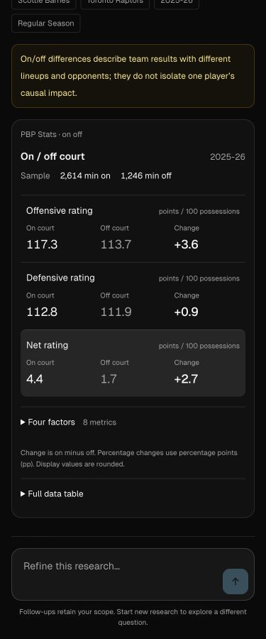
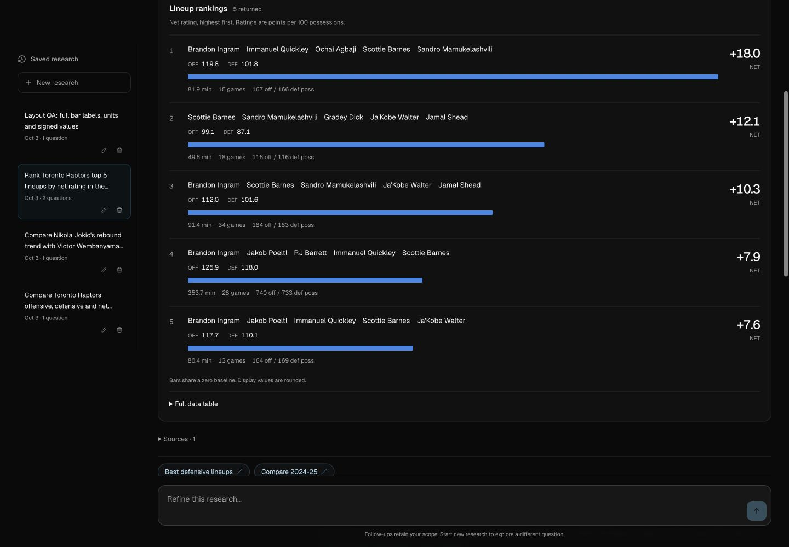

# Research artifact refinement

Reading this as a preserve-mode refinement of an NBA research workspace for fans and analysts. Keep the existing Svelte, Geist, dark neutral tokens, blue data accent and navigation. The design-taste skill explicitly excludes dense dashboards/data tables; use its audit, typography, accessibility and responsive principles contextually rather than applying marketing layouts. Design variance 3, motion intensity 1, visual density 6: stable, compact comparisons with movement only for user interactions.

## Audit and changes

The source screenshots show long lineup names competing with many equally weighted columns, repeated minutes and a separate unit column, excessive decimal precision, an oversized two-value on/off chart, and truncated category labels. Fixed SVG coordinates also shrink trend labels on narrow cards.

- On/off uses grouped ratings and expandable offensive/defensive four factors. The shared minute sample appears once. Percentages are inline; changes in percentage metrics explicitly use percentage points. Neutral signed changes do not label causal impact or universally equate a positive change with improvement.
- Lineup rankings give all five names room to wrap, emphasize the requested ranking metric and retain other ratings/sample denominators. Small bars share a zero baseline across all returned rows. The original ranked population/order is preserved; filtering does not rerank or change its scale.
- Canonical PBP tables and duplicate charts combine only when source provider, dataset, request and population match. Original artifact indices remain available for exports/event selection. Existing saved responses need no migration; malformed or unverified schemas keep generic rendering.
- Generic bars use wrapping HTML category labels and visible values. Signed bars share a zero baseline, including negative-only samples. Sorting and keyboard inspection remain available.
- Generic tables show compact primary fields with row details, and labeled summaries in narrow containers. Shared context moves above the table only when every row agrees. Units fold only when their meaning is known. Formatting changes display precision, not sorting values; exact precision is available.
- Trends use actual container-width coordinates, readable ticks, fewer short date labels, full HTML series names, and tap/button/keyboard inspection. Shot controls are at least 40px high on phones.

## References

[Cleaning the Glass on/off](https://www.cleaningtheglass.com/stats/player/1373/onoff) groups ratings and four factors and puts percentages with their values. [Dunks & Threes EPM](https://dunksandthrees.com/epm/actual) groups metrics by purpose and emphasizes signed values. These are presentation references, not new licensed data integrations.

[Datawrapper tables](https://www.datawrapper.de/academy/customizing-your-table) documents mobile transposed layouts and per-column formatting. [Datawrapper chart text](https://www.datawrapper.de/blog/text-in-data-visualizations) recommends horizontal bars for long categories. [Number formatting guidance](https://www.datawrapper.de/academy/options-to-change-number-formats-divide-round-prepend-append) supports fewer decimals and explicit units while preserving numeric source data.

## Verification

Browser verification replays saved on/off, lineup and two-player trend responses in an isolated local SQLite workspace. A labeled layout fixture covers long categories and signed bars. Source/model networks are disabled and no external model calls are made. The chosen layouts preserve the existing dark theme; this pass does not introduce a theme switch.

- 556 tests passed across 84 files; Svelte check reported zero errors and warnings. Production build, relocated transport startup and production HTTP smoke passed. The HTTP smoke used a loopback model fixture.
- Browser checks at 320, 375, 768, 1024 and 1440px found no document overflow or clipped lineup/category names. Lineup bar tracks have equal physical widths within each card. Trend ticks retain a 12px font at narrow widths, while the SVG viewBox matches the rendered card width.
- Exercised raw-value sorting, exact precision, bar ordering and keyboard inspection, trend navigation and series hiding/restoration, and density/FG% court toggles. Mobile court view/outcome controls measure 40px high. Full original dates remain in the trend inspector.
- Saved responses render through the new presentation components without modifying their stored source values or export identities. This verification covers presentation behavior, not new live-data accuracy or latency benchmarks.

[Responsive measurement record](evidence/artifact-responsive-checks-2026-10-03.json)

### Mobile comparison

### Desktop lineup ranking

