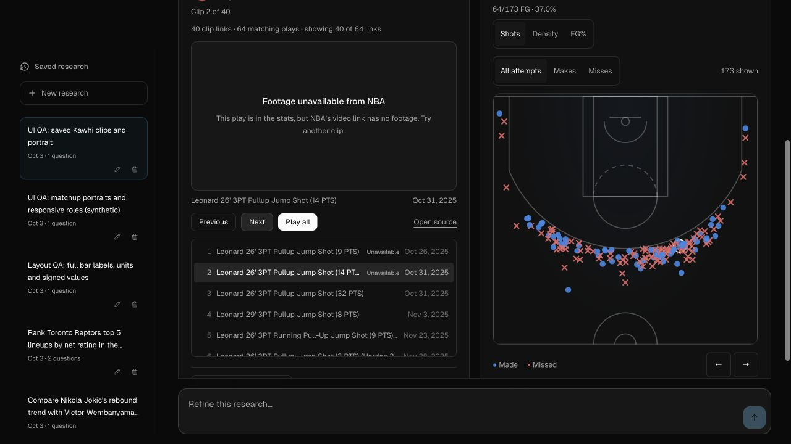

# Clip playback and answer reliability

## Observed failures

The saved Kawhi Leonard pull-up-three query contained 64 matching makes and 64 event-matched video links, but an application limit retained only 40. This was separate from video availability.

The exact November 3 clip (game `0022500164`, event `51`) returned HTTP 200 with a valid MP4 containing the NBA “Video Not Available” slate. Four sampled events from different dates had the same ETag and 31,580,089-byte content length. A bounded range download and FFmpeg frame at two seconds confirmed the encoded slate. No HTTP 429 occurred in those probes. Other resolutions of the same event did not provide a reliable replacement.

The preview also logged `DynamicAgentError` after source artifacts had appeared. The current error class is raised for invalid final model JSON/schema. The failed raw model response was not retained, so its exact truncation or schema fault cannot be established retrospectively. A deterministic truncated-JSON reproduction now verifies recovery from complete canonical custom-shot research while incomplete compound research still fails.

## Changes

- Queries retain all exact joined video links. Optional parser limits and the separately bounded export worker remain available. Existing saved 40-link responses need a new query/refinement to fetch the remainder.
- Model tool summaries omit full clips, shot rows and joined event-ID arrays. A 1,024-event fixture retained every clip and shot while reducing the tool message from 186,496 characters to fewer than 1,500. This measures context size, not live response latency.
- Canonical custom-shot charts no longer depend on a model-authored seed. Malformed narration can recover only narrowly verified complete scopes. Compound, opponent-identity and unsupported custom scopes are not inferred from partial results.
- Explicit inclusive shot-distance ranges must match executed filters. Direct feeds cannot silently replace shot-action/location/miss/quarter queries. Unrepresented clock filters return a scope error before fetching.
- The authenticated selected-clip availability route uses HEAD metadata, exact official NBA event provenance, cancellation, a three-second deadline, eight active checks, deduplication and a bounded cache. Only the verified ETag, byte length and media type together identify the known slate. Other HTTP 200 assets remain unverified, rather than being called playable.
- The player checks before loading footage, explains known unavailable sources, and labels missing clips. Automatic playback skips at most three consecutive unavailable selections before stopping. Exports reject the known slate before downloading it. No substitute event or guessed replacement URL is used.
- Progress uses natural current-activity messages, elapsed time and Cancel. Unfinished parallel work stays visible; activity changes reset the slow-step timer.
- PBP comparisons use one canonical takeaway. Equivalent on/off requests share one population; exact legacy saved numeric recitals are condensed while unique explanations and failures remain visible. Model instructions also discourage repeated artifact values.

## Verification

- `bun run test`: 612 passed, 0 failed across 93 files; network disabled.
- `bun run check`: 0 errors, 0 warnings.
- `bun run eval`: 28 passed, 0 failed.
- `bun run eval:custom-shots`: 7 passed, 0 failed.
- `bun run build`: passed, including relocated Node transport startup.
- `bun run check:endpoint-catalog-contracts`: passed.
- Actual availability HTTP endpoint against the reported clip: `unavailable / nba_unavailable`; sampled response took about 66 ms locally.
- Browser QA used an isolated database. The known unavailable clip had zero video elements, Next selected clip 2 without unintended playlist advancement, and Play all stopped after its bounded skip sequence. The mobile on/off response had one takeaway and no horizontal overflow at 390 px.
- No paid model calls were needed for this iteration. Unknown or changed placeholder fingerprints, actual footage availability and selected-host network behavior remain live acceptance concerns.

