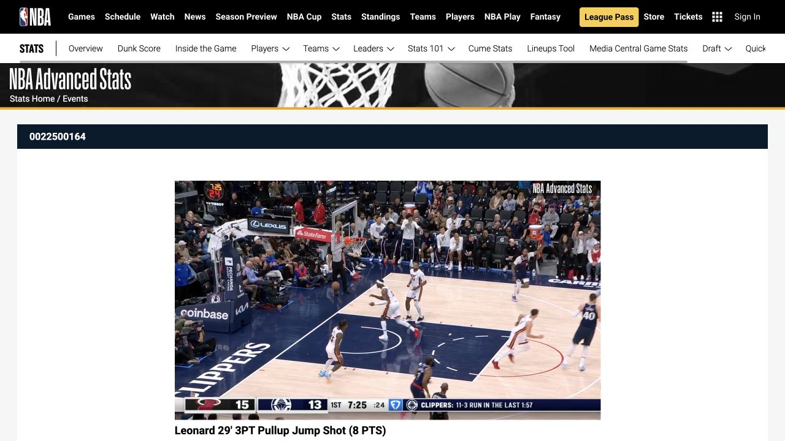
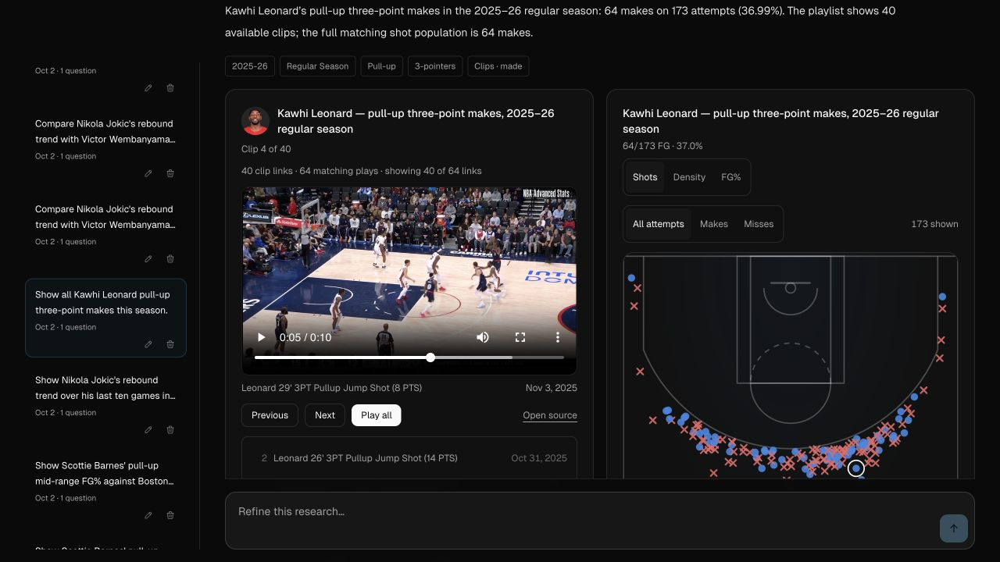
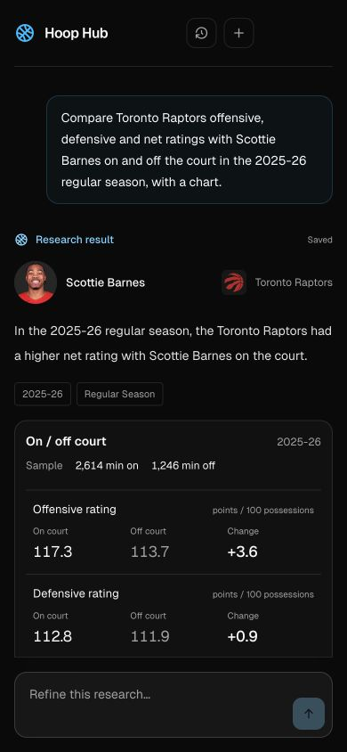

# Clip playback and answer reliability

## Observed failures

The saved Kawhi Leonard pull-up-three query contained 64 matching makes and 64 event-matched video links, but an application limit retained only 40. This was separate from video availability.

The initial bare media requests returned a valid MP4 containing the NBA “Video Not Available” slate, with the same ETag and 31,580,089-byte total size across events. That proved what those requests received, **not that the underlying footage was missing**. The follow-up investigation found that the app's document-wide `no-referrer` policy caused NBA to return that fallback. Removing only the referrer from an otherwise successful public GET reproduced it; sending the Hoop Hub origin returned the real clip. NBA's own player and the repaired app both played the exact November 3 event (`0022500164:51`). No HTTP 429 occurred in these probes.

The poster can load while the video request receives the fallback, explaining the brief preview before the slate. Existing browser media caches also retained fallback bytes: a November 23 clip still had a 15.015-second, 1920×1080 fallback after the policy change, while the same URL with browser caching disabled played the real 6.667-second, 960×540 clip. NBA's media responses omitted `Vary` and `Cache-Control`. A stable, verified playback query now gives old saved URLs a fresh cache key; it returns the same ETag as the canonical real asset.

The preview also logged `DynamicAgentError` after source artifacts had appeared. The current error class is raised for invalid final model JSON/schema. The failed raw model response was not retained, so its exact truncation or schema fault cannot be established retrospectively. A deterministic truncated-JSON reproduction now verifies recovery from complete canonical custom-shot research while incomplete compound research still fails.

## Changes

- Queries retain all exact joined video links. Optional parser limits and the separately bounded export worker remain available. Existing saved 40-link responses need a new query/refinement to fetch the remainder.
- Model tool summaries omit full clips, shot rows and joined event-ID arrays. A 1,024-event fixture retained every clip and shot while reducing the tool message from 186,496 characters to fewer than 1,500. This measures context size, not live response latency.
- Canonical custom-shot charts no longer depend on a model-authored seed. Malformed narration can recover only narrowly verified complete scopes. Compound, opponent-identity and unsupported custom scopes are not inferred from partial results.
- Explicit inclusive shot-distance ranges must match executed filters. Direct feeds cannot silently replace shot-action/location/miss/quarter queries. Unrepresented clock filters return a scope error before fetching.
- Authenticated research HTML uses `strict-origin-when-cross-origin`, allowing only the app origin to reach external HTTPS media. Login, API and asset responses retain `no-referrer`. Source links retain opener isolation while allowing that origin-only referrer.
- The native player no longer waits for or trusts a server HEAD check. It retains exact event selection and ignores late events from replaced players. A stable `hoop_hub_media=referrer-v1` playback query repairs cached fallback responses without changing the event, asset path, saved canonical URLs or export provenance. Other hosts and existing upstream parameters are untouched.
- The authenticated diagnostic availability route now requests `bytes=0-1023` with public app request context and cancels the body immediately, including when ranges are ignored. Exact official NBA provenance, cancellation, a three-second deadline, eight active checks, deduplication and bounded caching remain. The slate classifier uses the full `Content-Range` total for HTTP 206. A diagnostic response is not a global claim that an event has no footage.
- Exports share the proper public GET context and reject the known slate response before downloading it. Media headers exclude cookies, authorization and private URL paths. Original download, byte, duration and redirect limits remain. No substitute event or resolution guessing is used.
- Progress uses natural current-activity messages, elapsed time and Cancel. Unfinished parallel work stays visible; activity changes reset the slow-step timer.
- PBP comparisons use one canonical takeaway. Equivalent on/off requests share one population; exact legacy saved numeric recitals are condensed while unique explanations and failures remain visible. Model instructions also discourage repeated artifact values.

## Verification

- `bun run test`: 615 passed, 0 failed across 94 files; network disabled. The subsequent stable-cache-key regression suite added two passing tests.
- `bun run check`: 0 errors, 0 warnings.
- The preceding answer-reliability iteration passed 28 local agent evals and seven custom-shot contracts; this follow-up changes media delivery only.
- `bun run build`: passed, including relocated Node transport startup.
- Production HTTP smoke passed, including authenticated research versus login/API referrer policy, ownership, CSRF, quotas, streaming cancellation and restart persistence, using a loopback model fixture.
- Actual public Node GETs for the reported clip returned 5,613,822 bytes with app context and 31,580,089 bytes when only the referrer was removed. Browser source playback was 10.033 seconds. Compact public headers and comparisons are recorded in [media probes](evidence/nba-referrer-media-probes.json).
- With normal browser caching enabled, the repaired saved playlist played the November 3 clip at 5.722 seconds, and the previously cached November 23 clip had its real 6.667-second duration. Next and Play all selected their correct versioned source URLs.
- A real one-clip export for the November 3 event completed without omissions. FFprobe confirmed video plus audio and a 10.017-second normalized MP4.
- No paid model calls were needed. Browser media playback remains a separate acceptance gate from fixture-backed answer and export tests; local success does not certify another host's upstream behavior.

