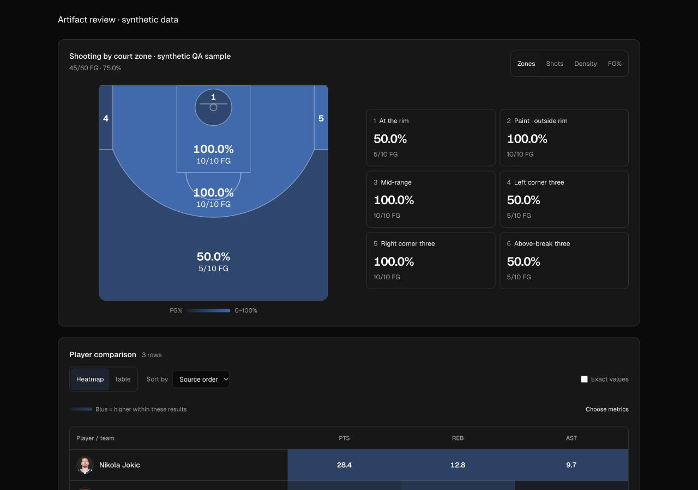
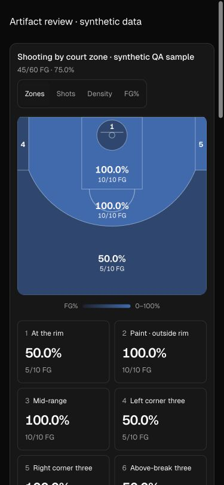
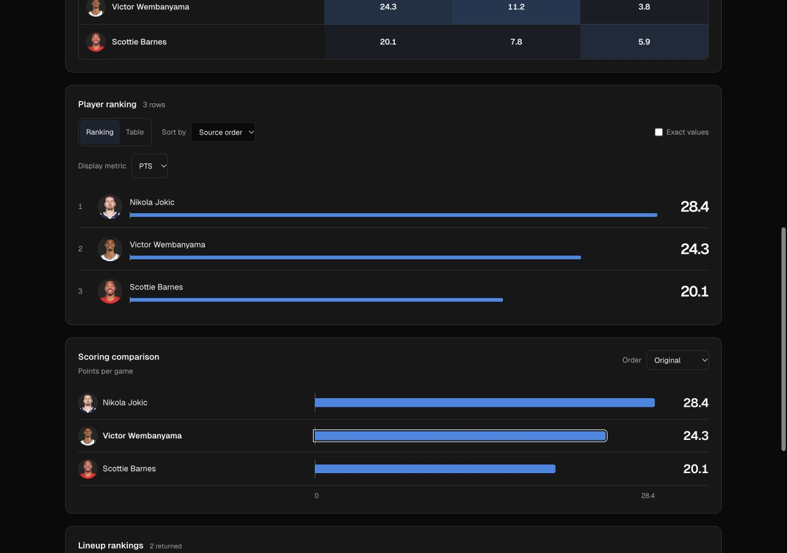
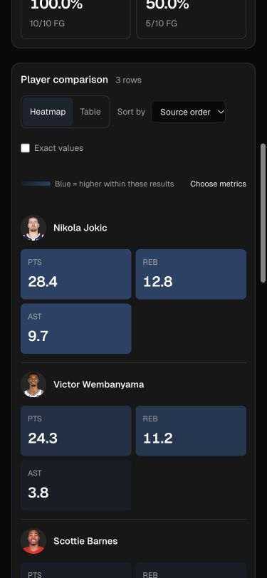

# Interactive basketball graphics

Implemented the direction recorded in [the Basketball University reference review](BASKETBALL_UNIVERSITY_VISUAL_REFERENCE_2026-10-04.md), preserving Hoop Hub's existing dark theme and validated artifact contracts.

## Changes

- Larger, multi-area shot samples open in a six-region zone view: rim, paint outside the rim, mid-range, both corners and above-break threes. Percentages retain makes/attempts; empty zones remain empty rather than 0%. Select a zone to inspect its paginated attempts, then select an event through the existing shot/clip identity join. Sparse or single-area queries open on individual shots; zones, density and FG% bins remain available.
- On wide cards the court and zone summaries sit side by side. Narrow cards stack the court above a two-column zone selector. Narrow rim/corner regions use numbered markers corresponding to readable summaries rather than squeezing tiny statistics onto the court.
- Eligible exact player/team comparisons open in an interactive heatmap. Choose metrics, filter and sort rows, inspect exact values, or switch to the original table. Color uses each metric's full returned population; filtering or pagination does not silently renormalize the color scale. Missing cells are uncolored, equal-valued columns have a neutral common intensity, and the legend says higher rather than better.
- Eligible rankings use portraits/logos, a prominent selected metric and shared zero-based comparison tracks. Source ranking order and supplied rank fields remain intact; selecting a different displayed metric does not silently rerank the research. Requested source order columns are prioritized where available. The table remains accessible.
- Long-form semantic comparisons keep their actual shared metric label instead of a generic Value caption. Rows with incompatible metric names/units, duplicate identities, ambiguous names or event actions retain table presentation. Differing seasons/scopes and game samples remain visible on graphical entity rows.
- Existing bar charts have larger values, clearer portraits and position labels when explicitly sorted. Lineup rankings now show grounded player portraits while preserving all five names, samples and the requested ranking statistic.

## Data boundaries

Zones are coordinate-derived spatial groups using the existing NBA half-court geometry, with explicit two/three-point values taking precedence around the arc. Off-court attempts remain in the overall shooting denominator and the existing unplotted-attempt disclosure. Sampled artifacts retain their sample designation. Zone percentages describe the provided attempts, including any requested outcome filters; they are not unfiltered season estimates.

Neither zone colors nor comparison heatmaps claim league-relative performance or percentiles. A matching league baseline is not available in the current artifact contract. No new analytics subscription, provider integration, image-copying permission or share-image export is implied by this pass.

## Validation

- Full local suite: 623 tests passed across 97 files; subsequent row-context regression and all 37 chart tests passed. Final Svelte check reported zero errors/warnings; production build and relocated Node transport startup passed.
- Browser checks used a temporary route rendering the real production components with explicitly labeled synthetic data. The temporary route was removed before the final production build. No model/stats API requests were made. Production preview also reopened saved Scottie Barnes research and reconciled its two mid-range attempts (one make) with the new zone summary.
- At 320px and 375px, document width matched viewport width and lineup/ranking entries did not overflow. Desktop checks used 1280px. Official entity images loaded successfully.
- Exercised zone selection, keyboard activation, zone attempt pagination, original event identity (event 48 retained original index 48), adding FG% to a heatmap, and switching between graphical/table presentation.
- League-baseline accuracy and new live provider data were not exercised; this change is presentation of already returned evidence.

## Visual evidence

All screenshots below use synthetic QA values, not NBA research results.

