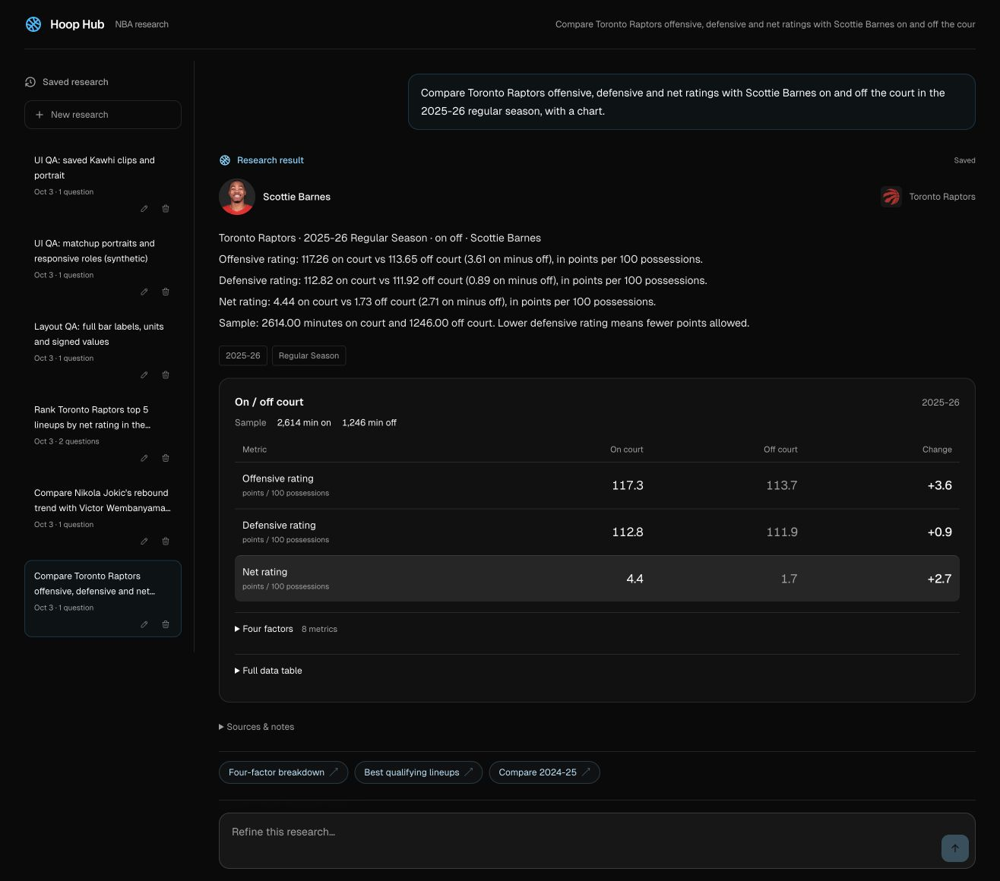
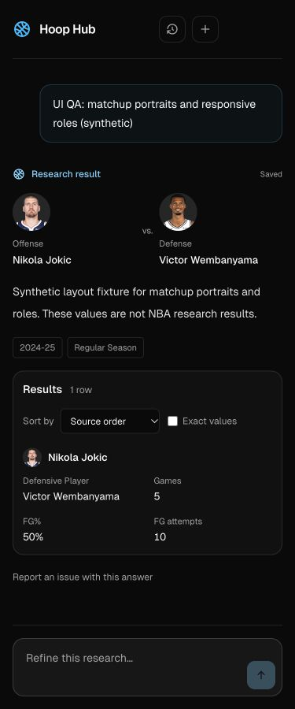

# Research UI cleanup and entity media

## Presentation

- Removed repetitive bar/trend instructions, baseline/rounding footers, composer reminders, export-cap helper text and per-artifact provider labels. Keyboard guidance remains accessible to screen readers. A shot detail panel appears after inspection; coordinate omissions are expandable.
- Combined citations and background methodology into one collapsed **Sources & notes** disclosure. Lineup coverage retains a concise label. Stale data, incomplete answers, unsupported capabilities and unknown warning types remain visible. Older duplicate model wording of the same canonical lineup coverage note is suppressed narrowly.
- Player/team subject chips became compact visual identities. Matchups preserve offense/defense roles from successful requests or canonical saved rows; general two-player trends are not relabeled as head-to-head matchups.
- Clip portraits use each playlist's validated player ID. Older one-player responses have a single-subject fallback; multi-player playlists without an identity stay undecorated. Generic tables and bars add small avatars/logos beside exact recognized identity names.
- Existing contextual follow-ups remain server-generated from verified research scope and supported refinements. This pass does not introduce another model call for suggestions.

## Media grounding

The compact browser index is generated from canonical directory snapshots and checked for drift. It contains identities, not roster assignments. IDs and names must agree; ambiguous or unknown references receive a text/initials fallback. Images have fixed dimensions, lazy loading, asynchronous decoding, no-referrer requests and a failure fallback.

[NBA.com's Nikola Jokic profile](https://www.nba.com/player/203999/nikola-jokic) links official headshot and logo assets. The 260×190 portrait and Toronto primary SVG endpoints returned HTTP 200 with image content types; browser QA loaded Jokic, Wembanyama, Kawhi, Scottie and Toronto assets. Latest portraits are decorative and do not establish historical team membership. Only teams explicitly grounded in the research scope get team badges.

Regenerate the compact index after directory changes:

```sh
cd apps/web
bun scripts/generate-entity-media-index.ts
```

## Verification

- 569 tests passed across 87 files. Svelte check reported zero errors/warnings. Production build and relocated transport startup checks passed.
- Browser verification used an isolated SQLite replay of saved lineup/on-off/clip responses and a clearly labeled synthetic matchup fixture. No model or stats API calls were made; the browser loaded official CDN images and saved clip media metadata.
- Checked 320, 375, 768, 1024 and 1316px widths: no document overflow, no clipped generic bar labels, correct matchup roles and per-playlist portrait identity. Both saved lineup results have no yellow limitation banner or baseline footer; source details remain expandable.
- Independent review found no actionable grounding, accessibility, image lifecycle or responsive regression. Changes were committed in scoped cleanup, avatar, integration and compatibility commits.

[Browser measurement record](evidence/research-media-checks-2026-10-03.json)





[Saved clip portrait screenshot](evidence/research-media-clips-desktop-2026-10-03.jpg) · [Cleaned lineup screenshot](evidence/research-cleanup-lineups-desktop-2026-10-03.jpg)
