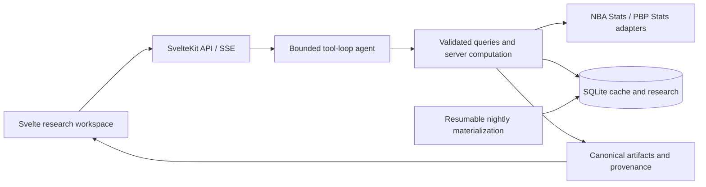

# Hoop Hub

[](https://github.com/agocharbhatia/hoop-hub/actions/workflows/ci.yml)

An NBA research workspace that turns natural-language questions into source-backed statistics, interactive charts, and video playlists of the exact plays being analyzed.

**[Try Hoop Hub](https://hoop-hub.132.145.109.69.sslip.io)** · [Run locally](#try-it-locally) · [Architecture](docs/architecture.md)

Ask how a player's shooting changed, compare lineups, or filter shots by opponent and action. Results retain their source, filters, sample sizes, and missing-data warnings. Follow-up questions refine the same research; saved sessions and boards keep the useful findings together.

## Questions you can ask

These are source-backed research results, including saved sessions rendered in the current app. Click a screenshot for the full-size result. The video capture shows an earlier playback session; NBA footage availability can change.

| Question | Result |
| --- | --- |
| **Filtered shots and a video playlist**<br><br>“Show Kawhi Leonard's pull-up three-point FG% in the 2025-26 regular season, plot all attempts, and build a video playlist of the available makes.” | **64 makes / 173 attempts · 37.0% FG.** The saved playback capture contains 40 clip links from 64 matching makes.<br><br>[](docs/assets/question-playlist.jpg) |
| **Multiple players and different metrics**<br><br>“Compare Nikola Jokic's rebound trend with Victor Wembanyama's block trend over their last ten games in the 2024-25 regular season. Show charts and compare the earlier five with the latest five for each player.” | **10 games per player.** Jokic: 10.8 → 12.4 rebounds. Wembanyama: 3.4 → 3.0 blocks. Separate charts preserve each player's dates and metric.<br><br>[](docs/assets/question-trends.png) |
| **Before-and-after analysis across five metrics**<br><br>“Compare Scottie Barnes' per-game scoring, TS%, field-goal attempts, three-point attempt share, and turnovers before versus on/after January 1, 2025 in the 2024-25 regular season.” | **20 games before / 45 after.** Includes pooled TS%, attempt share, per-game averages, and percentage-point changes.<br><br>[](docs/assets/question-split.png) |
| **League-wide qualification and rankings**<br><br>“Compare three-point volume and efficiency across NBA players in 2025-26, with at least 200 attempts. Show the scatterplot and qualified ranking.” | **191 qualified players · 65,705 attempts.** The interactive explorer pairs the full qualified population with shooting benchmarks and rankings.<br><br>[](docs/assets/question-shooting.png) |
| **On/off impact across possession-based metrics**<br><br>“Compare Toronto Raptors offensive, defensive and net ratings with Scottie Barnes on and off the court in the 2025-26 regular season, with a chart.” | **2,614 minutes on / 1,246 off.** Toronto's net rating: +4.4 on court versus +1.7 off, a +2.7-point difference per 100 possessions.<br><br>[](docs/assets/question-on-off.png) |
| **Possession-qualified lineup rankings**<br><br>“Rank Toronto Raptors top 5 lineups by net rating in the 2025-26 regular season, with at least 100 offensive and defensive possessions.” | **Five lineups from ten returned qualifiers.** Every row retains minutes, games, offensive/defensive possessions, and ratings. The result flags that the provider may cap its lineup population.<br><br>[](docs/assets/question-lineups.png) |

For filtered shot research, follow up with “Only the fourth quarter” or “Show the misses instead” to refine the same scope. Results depend on source coverage; on/off and lineup analysis require the optional PBP Stats provider.


*Explore shooting volume and efficiency with qualified populations, player highlights, and linked rankings. This preview uses synthetic fixtures; reproduce it with `bun run demo`.*

## The engineering behind it

The hard part is keeping a flexible language-model interface tied to the right data population. The model selects tools; the server validates scope, computes supported statistics, and constructs or reconciles the corresponding artifacts from source rows.

| Problem | Implementation | Evidence to inspect |
| --- | --- | --- |
| A plausible answer can contain invented numbers or chart points. | Canonical server computations replace supported trend, split, ranking, matchup, and shot artifacts. Missing evidence produces an explicit coverage gap. | [Historical NBA oracle test](apps/web/src/lib/server/agent/real-nba-trend-gold.test.ts), [trend grounding](apps/web/src/lib/server/agent/trend-grounding.test.ts) |
| Ranking the rows shown to the model can miss the actual leaders. | Qualification, aggregation, and ordering run over the full retrieved population before applying the output limit. | [Ranking regression](apps/web/src/lib/server/agent/ordered-ranking.test.ts) places the winners beyond the model's row sample and excludes an unqualified outlier. |
| A shot chart and its highlights can quietly describe different events. | Custom shot filters select attempts first, then join video by `(gameId, eventId)`. Shooting percentages retain the full attempt denominator when footage is missing. | [Exact shot/video joins](apps/web/src/lib/server/agent/custom-shot-clips.ts), [coverage regressions](apps/web/src/lib/server/agent/clip-research.test.ts) |
| Compound questions duplicate upstream work and leave slow requests running. | Equivalent requests share one retrieval within an answer; independent data tools run in batches of three. Streaming cancellation reaches model calls and data transports. | [Request reuse and cancellation](apps/web/src/lib/server/agent/query-runtime.ts), [runtime tests](apps/web/src/lib/server/agent/query-runtime.test.ts) |
| Upstream APIs fail, rate-limit, or return incomplete data. | Persistent, versioned caches retain provenance and explicit freshness. Nightly materialization resumes per request; audits check payload hashes and request/cache agreement. | [Provider recovery](apps/web/src/lib/server/data/providers/client.ts), [nightly bootstrap](apps/web/src/lib/server/nightly/bootstrap-service.ts), [data health](apps/web/src/lib/server/nightly/data-health.ts) |
| Research must remain private across sessions and exports. | Server-side ownership checks cover saved research, boards, traces, feedback, and clip exports. Admission controls bound per-user and global work. | [Ownership tests](apps/web/src/lib/server/beta/ownership.test.ts), [board isolation](apps/web/src/lib/server/research/boards.test.ts), [admission controls](apps/web/src/lib/server/beta/limits.ts) |

See [architecture and tradeoffs](docs/architecture.md) for the request flow and [engineering evidence](docs/engineering-evidence.md) for concrete failure cases and reproducible checks.

## Visualizations

Captured from the running app with synthetic QA data. Click any image for the full-size view. Explore the controls locally at `/dev/research` and `/dev/charts`.

| Shot-zone analysis | Multi-player trends |
| --- | --- |
| [](docs/assets/shot-zones.png) | [](docs/assets/player-trends.png) |
| Court regions retain exact makes and attempts; empty zones stay unavailable. Switch between zones, individual shots, density, and FG% views. | Compare original observations with rolling averages and window means. Toggle subjects or inspect individual games. |

| Player comparison | Before-and-after splits |
| --- | --- |
| [](docs/assets/player-comparison.png) | [](docs/assets/research-preview.png) |
| Paired metric rows preserve units, sample sizes, signed differences, and expandable supporting counts. | Compare dated cohorts with pooled shooting percentages, exact sample windows, and metric-specific change indicators. |

## Try it locally

Requires **Node 22.19+** and **Bun 1.3.14**. Production runs on Node with built-in SQLite; Bun handles development, tests, and builds.

```bash
git clone https://github.com/agocharbhatia/hoop-hub.git
cd hoop-hub/apps/web
bun install --frozen-lockfile
bun run demo
```

Open **http://127.0.0.1:4173/dev/research**. This preview renders the real research components with synthetic fixtures in a dedicated `.data/demo.sqlite` database. No model credentials or live NBA retrieval are needed for the preview. Use `/dev/charts` to inspect the individual chart interactions.

For natural-language research, copy the [environment template](apps/web/.env.example) to `apps/web/.env`, configure `OPENAI_API_KEY` and `OPENAI_AGENT_MODEL`, and run `bun run dev` instead. Setup and the distinction between live and materialized data are in the [development guide](docs/development.md).

## Architecture at a glance



**Stack:** TypeScript, Svelte 5, SvelteKit, SQLite, OpenAI tool calling, Bun, Node, Docker, and FFmpeg.

The natural-language route is `POST /api/query`; `POST /api/stats/query` exposes the typed semantic runtime directly. Traces record tool requests, source calls, cache state, warnings, latency, and model usage. The [app reference](apps/web/README.md) maps the routes and modules.

## Verify it

From `apps/web`:

```bash
bun run check:repo
bun run check
bun run check:endpoint-catalog-contracts
bun run test
bun run eval
bun run eval:custom-shots
bun run build
```

The default tests and evaluations run offline without API credentials. The evaluation harness executes scripted tool decisions through the real agent service, checks numeric and artifact contracts, and writes redacted reports. Historical NBA snapshots provide an additional independent raw-row oracle. Paid model evaluations and live-source checks are separate, explicit commands; fixture timings are not production latency measurements.

[CI](.github/workflows/ci.yml) also exercises the built HTTP server and Docker persistence/backup behavior. See the [evaluation guide](docs/engineering-evidence.md) for what each check establishes.

## Scope and tradeoffs

This is a side project with a single-process deployment model. SQLite keeps setup, persistence, and snapshots simple; the clip-export queue and concurrency controls are process-local. Multiple replicas would require shared admission and job coordination. Production throughput and availability have not been benchmarked.

NBA endpoint access and video availability depend on the upstream sources and network. Tracking-derived matchup aggregates do not establish defender attribution for individual clips. Unsupported filters and unavailable populations stay explicit. Canonical reconciliation covers supported computations; arbitrary generated prose is not a general factual guarantee.

The repository includes [Docker deployment and recovery instructions](.docs/BETA_DEPLOYMENT.md), [environment configuration](deploy/beta.env.example), and [hosted acceptance checks](.docs/RELEASE_CHECKLIST.md). Publishing the source and operating a public data demo are separate steps; public-display checks are enforced by the application. NBA data, logos, and footage belong to their respective owners. This project is not affiliated with the NBA.
