# Hoop Hub

[](https://github.com/agocharbhatia/hoop-hub/actions/workflows/ci.yml)

Ask NBA questions and get stats, charts, and clips of the matching plays.

**[Try Hoop Hub](https://tryhoophub.duckdns.org)** · [Run locally](#try-it-locally) · [Architecture](docs/architecture.md)

Compare players and lineups, track changes over a season, or find specific shots. Each result shows its sources, filters, sample size, and missing data. Ask follow-up questions, reopen saved research, or collect results on a board.

## Questions you can ask

These screenshots show actual query results and saved research. Click to enlarge. The video screenshot is from an earlier session; footage availability can change.

| Question | Result |
| --- | --- |
| **Shots and video**<br><br>“Show Kawhi Leonard's pull-up three-point FG% in the 2025-26 regular season, plot all attempts, and build a video playlist of the available makes.” | **64/173 shooting (37.0%).** The saved session shows 40 clip links for 64 makes.<br><br>[](docs/assets/question-playlist.jpg) |
| **Player trends**<br><br>“Compare Nikola Jokic's rebound trend with Victor Wembanyama's block trend over their last ten games in the 2024-25 regular season. Show charts and compare the earlier five with the latest five for each player.” | **10 games per player.** Jokic: 10.8 → 12.4 rebounds. Wembanyama: 3.4 → 3.0 blocks. Each chart uses that player's own game dates.<br><br>[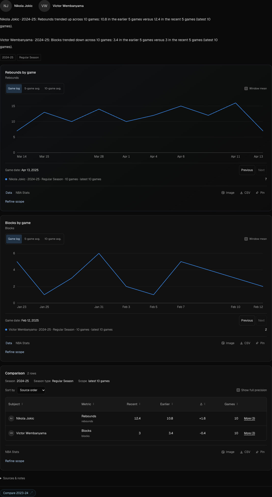](docs/assets/question-trends.png) |
| **Before and after**<br><br>“Compare Scottie Barnes' per-game scoring, TS%, field-goal attempts, three-point attempt share, and turnovers before versus on/after January 1, 2025 in the 2024-25 regular season.” | **20 games before / 45 after.** Compares five metrics, with pooled TS% and changes in percentage points.<br><br>[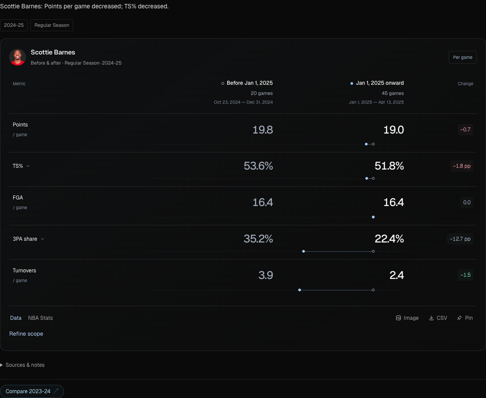](docs/assets/question-split.png) |
| **League shooting rankings**<br><br>“Compare three-point volume and efficiency across NBA players in 2025-26, with at least 200 attempts. Show the scatterplot and qualified ranking.” | **191 qualified players · 65,705 attempts.** Compare all qualifying players with group averages and rankings.<br><br>[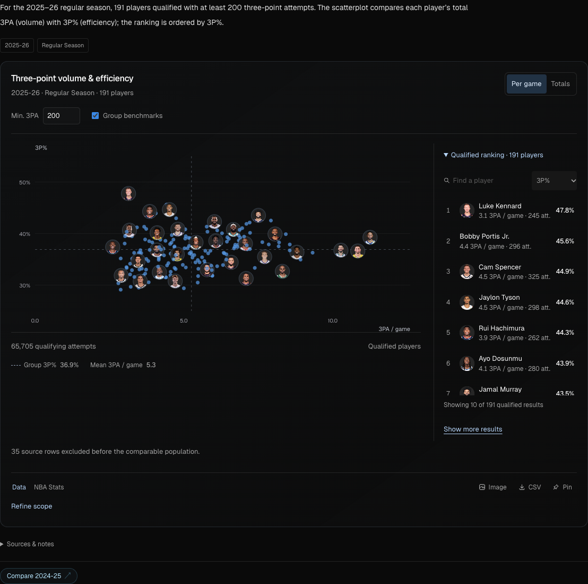](docs/assets/question-shooting.png) |
| **On/off ratings**<br><br>“Compare Toronto Raptors offensive, defensive and net ratings with Scottie Barnes on and off the court in the 2025-26 regular season, with a chart.” | **2,614 minutes on / 1,246 off.** Toronto's net rating: +4.4 on court versus +1.7 off, a +2.7-point difference per 100 possessions.<br><br>[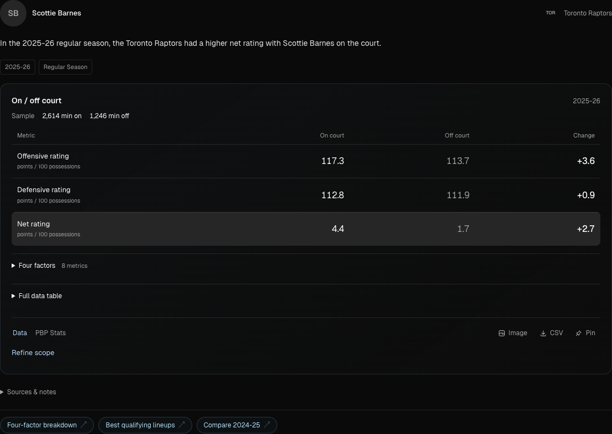](docs/assets/question-on-off.png) |
| **Lineup rankings**<br><br>“Rank Toronto Raptors top 5 lineups by net rating in the 2025-26 regular season, with at least 100 offensive and defensive possessions.” | **Five of ten qualifying lineups returned.** Shows minutes, games, possessions, and ratings. The provider may cap its results; the app flags this limit.<br><br>[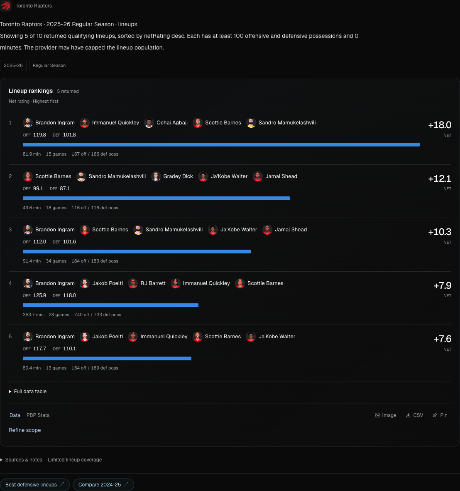](docs/assets/question-lineups.png) |

Refine a shot query with “Only the fourth quarter” or “Show the misses instead.” Data coverage varies. On/off and lineup queries need the optional PBP Stats provider.

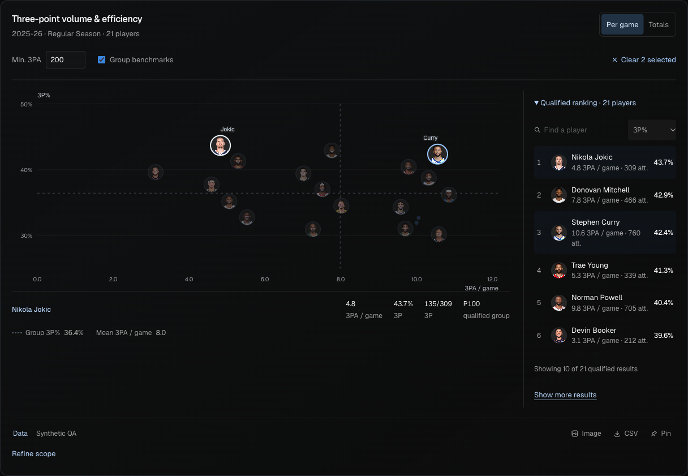

*Shooting explorer with sample data. Run `bun run demo` to try it locally.*

## How it works

The model chooses tools. The server checks the query filters, calculates supported stats, and builds or corrects charts and tables from the source data.

| Problem | Approach | Code and tests |
| --- | --- | --- |
| The model can invent numbers. | The server replaces supported trend, split, ranking, matchup, and shot results with calculated values. Missing data stays explicit. | [Historical NBA oracle test](apps/web/src/lib/server/agent/real-nba-trend-gold.test.ts), [trend grounding](apps/web/src/lib/server/agent/trend-grounding.test.ts) |
| A sample can miss the leaders. | Filter, aggregate, and sort all retrieved rows before limiting the output. | [Ranking regression](apps/web/src/lib/server/agent/ordered-ranking.test.ts) checks winners outside the model's sample and excludes an unqualified outlier. |
| Charts and clips must match. | Filter shots, then join video by `(gameId, eventId)`. Missing footage does not change the shooting denominator. | [Exact shot/video joins](apps/web/src/lib/server/agent/custom-shot-clips.ts), [coverage regressions](apps/web/src/lib/server/agent/clip-research.test.ts) |
| Queries can repeat work or outlive the user's request. | Reuse identical requests within an answer. Run independent tools in batches of three. Cancel model and data requests when the user stops. | [Request reuse and cancellation](apps/web/src/lib/server/agent/query-runtime.ts), [runtime tests](apps/web/src/lib/server/agent/query-runtime.test.ts) |
| Data sources fail or rate-limit requests. | Versioned caches track sources and freshness. Nightly data jobs resume per request. Audits check payload hashes and cache consistency. | [Provider recovery](apps/web/src/lib/server/data/providers/client.ts), [nightly bootstrap](apps/web/src/lib/server/nightly/bootstrap-service.ts), [data health](apps/web/src/lib/server/nightly/data-health.ts) |
| Users must only access their own research. | Check ownership of saved research, boards, traces, feedback, and exports. Limit work per user and across the server. | [Ownership tests](apps/web/src/lib/server/beta/ownership.test.ts), [board isolation](apps/web/src/lib/server/research/boards.test.ts), [admission controls](apps/web/src/lib/server/beta/limits.ts) |

Details: [architecture](docs/architecture.md) and [engineering tests](docs/engineering-evidence.md).

## Visualizations

These views use sample data. Click to enlarge, or try the controls at `/dev/research` and `/dev/charts`.

| Shot-zone analysis | Multi-player trends |
| --- | --- |
| [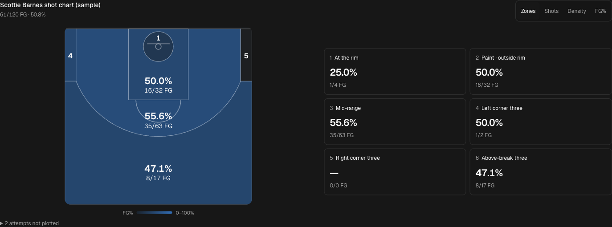](docs/assets/shot-zones.png) | [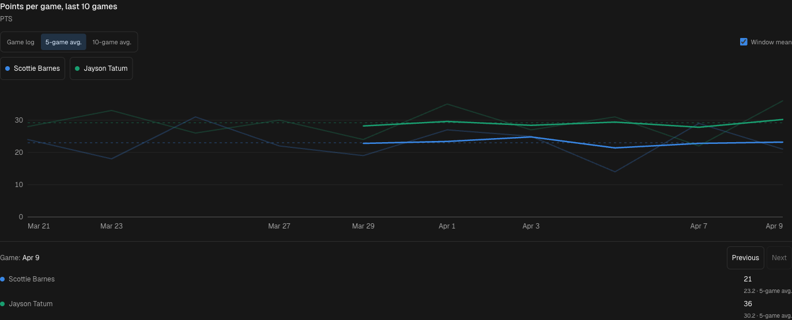](docs/assets/player-trends.png) |
| Makes and attempts by zone. Switch to individual shots, density, or FG%. Empty zones show no data. | Game logs, rolling averages, and averages over the selected window. Toggle players or inspect a game. |

| Player comparison | Before-and-after splits |
| --- | --- |
| [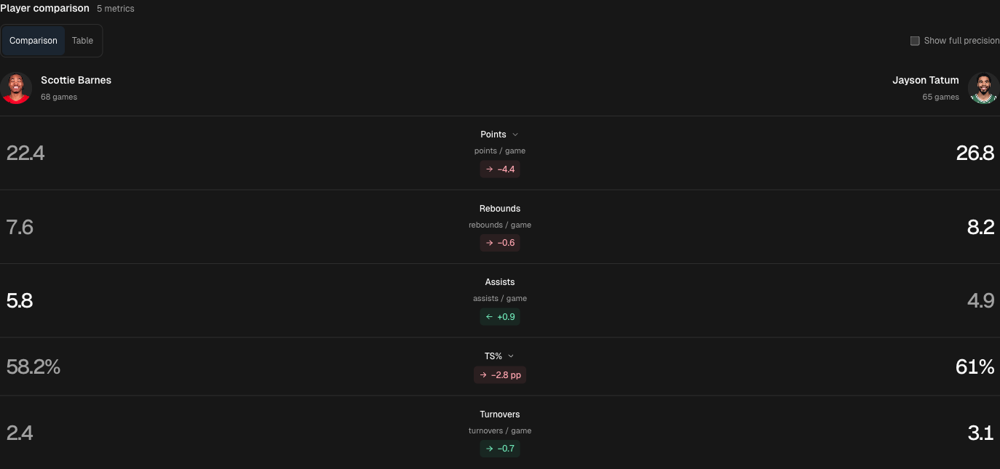](docs/assets/player-comparison.png) | [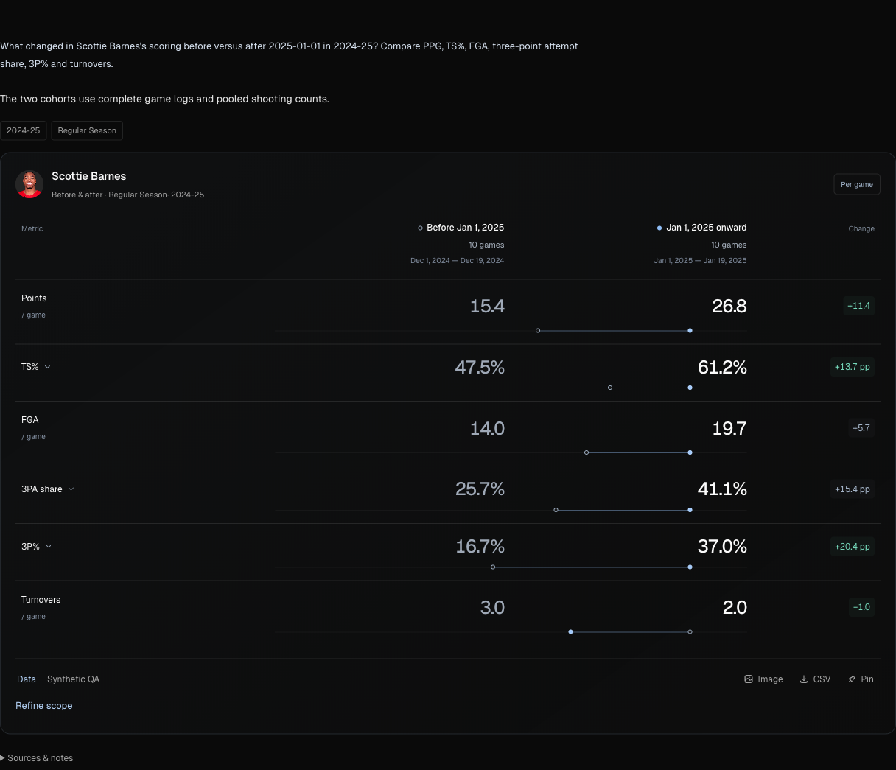](docs/assets/research-preview.png) |
| Compare players with units, sample sizes, differences, and supporting counts. | Compare periods with exact dates, pooled shooting percentages, and changes for each metric. |

## Try it locally

Requires **Node 22.19+** and **Bun 1.3.14**. Node runs production with built-in SQLite. Bun runs development, tests, and builds.

```bash
git clone https://github.com/agocharbhatia/hoop-hub.git
cd hoop-hub/apps/web
bun install --frozen-lockfile
bun run demo
```

Open **http://127.0.0.1:4173/dev/research**. The demo uses sample data in a separate `.data/demo.sqlite` database. It needs no API keys or live NBA access. Individual charts are at `/dev/charts`.

To ask real questions, copy the [environment template](apps/web/.env.example) to `apps/web/.env`, set `OPENAI_API_KEY` and `OPENAI_AGENT_MODEL`, then run `bun run dev`. The [development guide](docs/development.md) covers setup and live versus stored data.

## Architecture

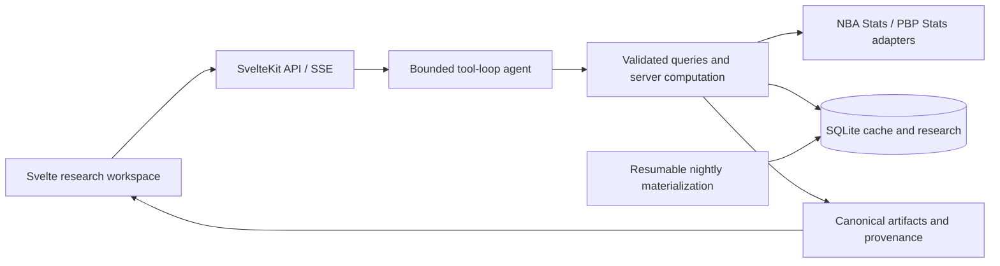

**Stack:** TypeScript, Svelte 5, SvelteKit, SQLite, OpenAI tool calling, Bun, Node, Docker, and FFmpeg.

Questions go to `POST /api/query`. Typed stats queries use `POST /api/stats/query`. Traces record tool and source calls, cache state, warnings, latency, and model usage. See the [app reference](apps/web/README.md) for routes and modules.

## Checks

From `apps/web`:

```bash
bun run check:repo
bun run check
bun run check:endpoint-catalog-contracts
bun run test
bun run eval
bun run eval:custom-shots
bun run build
```

Default tests and agent evaluations run offline without API keys. They run scripted tool calls through the agent and check numbers, charts, and tables. Historical NBA snapshots provide independent checks against raw game logs. Reports redact sensitive data. Paid model runs and live-source checks use separate commands. Test-fixture timings do not measure production latency.

[CI](.github/workflows/ci.yml) also checks the built HTTP server, Docker persistence, and backups. The [evaluation guide](docs/engineering-evidence.md) explains each check.

## Limits

The app runs as one process with SQLite. The export queue and concurrency limits live in that process. Running multiple replicas would need shared job and request coordination. Production throughput and availability have not been benchmarked.

NBA data and video availability depend on the source and network. Matchup stats cannot identify the defender in an individual clip. The app flags unsupported filters and missing data. Server calculations cover supported stats; generated text can still be wrong.

Deployment: [Docker and recovery](.docs/BETA_DEPLOYMENT.md), [environment settings](deploy/beta.env.example), and [hosted checks](.docs/RELEASE_CHECKLIST.md). Public data display requires separate permission checks enforced by the app. NBA data, logos, and footage belong to their respective owners. This project is not affiliated with the NBA.

Pushes to `main` deploy to the Oracle server after CI passes. See [production updates and rollback](docs/deployment.md).
